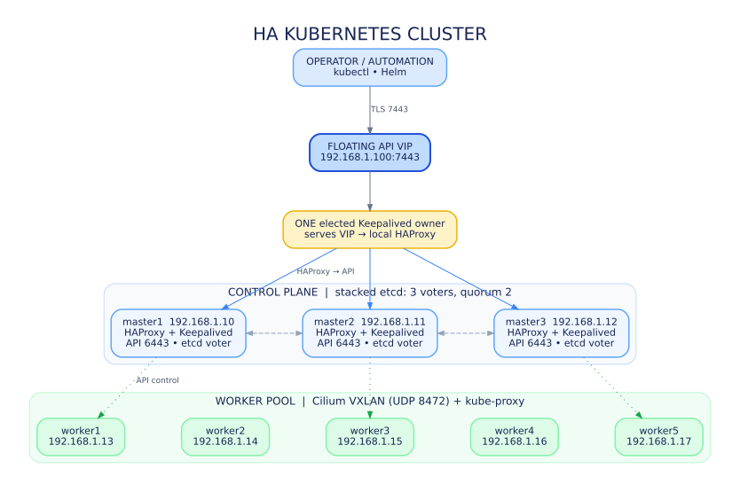
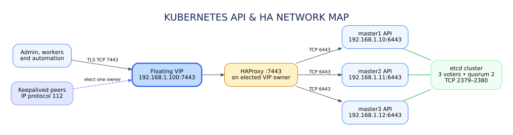
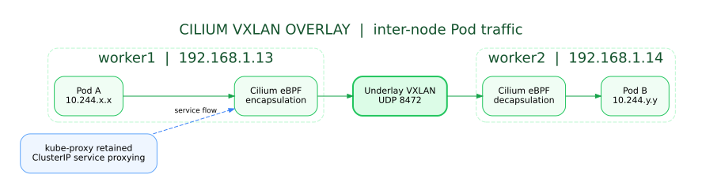

# Architecture and network diagrams

## Architecture

Shows master1 (`192.168.1.10`), master2 (`192.168.1.11`), master3 (`192.168.1.12`), stacked etcd, the floating VIP `192.168.1.100` and all five workers (`192.168.1.13`–`192.168.1.17`).

## Kubernetes API control flow

- Admin or kubelet → **VIP:7443** (owned by *one* CP's Keepalived)
- Current VIP owner HAProxy → healthy `kube-apiserver:6443` on master1, master2 or master3
- Control-plane nodes ↔ each other via etcd TCP 2379/2380
- Keepalived peers exchange unicast **IP protocol 112**, not a TCP/UDP port

See [network-map.md](network-map.md) for the exact firewall matrix.

## Cilium overlay data path

- Pod on worker1 → Cilium datapath → VXLAN **UDP 8472** on underlay → remote Cilium datapath → Pod on worker2.
- kube-proxy **remains enabled** for service proxying in this specific setup.
- DNS/service traffic, external routing, MTU and policy outcomes depend on actual cluster configuration.

## Failover state diagram

[Open Mermaid failover flow](failover-flow.md) —
