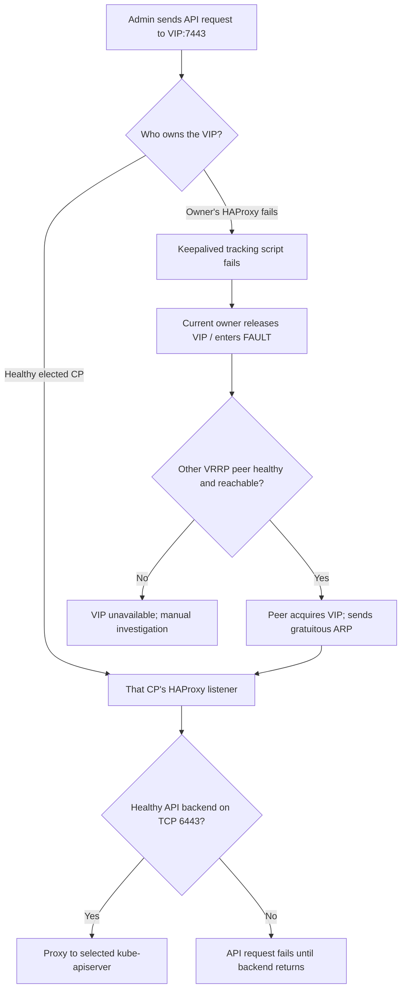

# VIP failover decision flow

## What to observe

- Failover might introduce an **observable gap** until peer election and ARP update complete.
- If protocol 112 is blocked or a peer owns the VIP elsewhere, **split brain** is possible; stop tests and inspect infrastructure.
- VIP failover is independent of etcd **majority**: a reachable API process cannot complete state changes if etcd quorum is unavailable.
